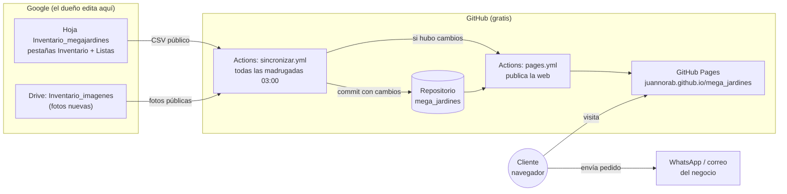

# Mega Jardines · web, inventario y bot

Web de **Mega Jardines** (vivero y jardinería en Quito), reconstruida desde cero a partir del sitio original.

- **Web publicada:** https://juannorab.github.io/mega_jardines/
- **Inventario (Google Sheets):** [Inventario_megajardines](https://docs.google.com/spreadsheets/d/1y0PDmb3mT7-eC90OWYbp2bXlb4QKvxPfss0CrsUib3Q/edit)
- **Fotos nuevas (Google Drive):** carpeta *Inventario_imagenes*
- **Automatizaciones:** pestaña [Actions](https://github.com/JuanNoraB/mega_jardines/actions) de este repositorio

---

## Índice

1. [Resumen en 30 segundos](#1-resumen-en-30-segundos)
2. [Arquitectura](#2-arquitectura)
3. [Tecnologías y por qué](#3-tecnologías-y-por-qué)
4. [Estructura de carpetas](#4-estructura-de-carpetas)
5. [Cómo funciona cada pieza](#5-cómo-funciona-cada-pieza)
6. [Tareas del día a día](#6-tareas-del-día-a-día)
7. [Probar en tu computadora](#7-probar-en-tu-computadora)
8. [Costos](#8-costos)
9. [Límites y decisiones](#9-límites-y-decisiones)
10. [Pendientes](#10-pendientes)
11. [Glosario](#11-glosario)

---

## 1. Resumen en 30 segundos

- La web es **estática**: solo archivos HTML, CSS, JavaScript e imágenes. No hay base de datos ni servidor propio.
- El **catálogo** (571 productos) vive en una **hoja de Google**. El dueño la edita como un Excel.
- Cada madrugada, un **servidor gratuito de GitHub** lee la hoja, actualiza la web y la publica. Si nada cambió, no hace nada.
- Los clientes arman un **pedido** en la web y lo envían por **WhatsApp** o **correo**. No hay pagos en línea: el negocio confirma y cobra por su cuenta.
- Hay un **bot de WhatsApp** opcional (proyecto aparte) que muestra el catálogo por chat y pasa a una persona cuando hace falta.

---

## 2. Arquitectura



**Flujo de un cambio de precio:**

1. El dueño cambia el precio en la hoja.
2. A las 03:00 (o al pulsar *Run workflow*), GitHub Actions ejecuta `sincronizar.ps1` en un servidor Windows.
3. El script descarga la hoja como CSV, valida los datos, baja fotos nuevas de Drive y regenera `megajardines/assets/data.js`.
4. Si algo cambió, hace un commit al repositorio y llama a `pages.yml`, que publica la carpeta `megajardines/` en GitHub Pages.
5. El cliente abre la web y el navegador carga el `data.js` nuevo (la versión `?v=...` evita que vea precios viejos guardados en caché).

---

## 3. Tecnologías y por qué

| Pieza | Tecnología | Por qué |
|---|---|---|
| Páginas | HTML5 + CSS3 (sin frameworks) | Carga rápido, funciona en cualquier hosting, fácil de mantener sin compilar nada. |
| Interactividad | JavaScript "vanilla" (sin React ni librerías) | El catálogo, el carrito y los filtros caben en ~500 líneas; no hace falta más. |
| Tipografías | Google Fonts (Fraunces e Inter) | Aspecto profesional sin archivos extra. |
| Datos del catálogo | `data.js` generado desde Google Sheets | El dueño edita en una hoja; la web lee un archivo estático y rápido. |
| Carrito | `localStorage` del navegador | Guarda el pedido en el dispositivo del cliente, sin servidor ni cuentas. |
| Envío de pedidos | Enlaces `wa.me` y `mailto:` | Cero costo, cero servidor; el negocio recibe el pedido donde ya trabaja. |
| Vista previa en WhatsApp | Etiquetas Open Graph (`og:image`) | Al compartir el enlace del pedido aparece una tarjeta con imagen. |
| Métricas | Google Analytics 4 (eventos) | Gratis; mide visitas, búsquedas, carritos y pedidos enviados. |
| Sincronización | PowerShell 5.1 + .NET (`System.Drawing`) | Viene con Windows; descarga, valida y optimiza fotos sin instalar nada. |
| Automatización | GitHub Actions (cron) | Servidor gratuito que corre el script cada madrugada. |
| Hosting | GitHub Pages | Gratis, con HTTPS, y admite dominio propio (megajardines.com). |
| Bot | Python 3 (solo librería estándar) + WhatsApp Cloud API de Meta | Sin dependencias; corre en cualquier servidor pequeño o en Docker. |

---

## 4. Estructura de carpetas

```text
mega_jardines/
├── README.md                     ← este archivo (índice del proyecto)
├── sincronizar.ps1               ← Google Sheets + Drive  →  web y bot
├── .gitignore                    ← lo que NO se sube (respaldos, secretos)
├── .github/workflows/
│   ├── sincronizar.yml           ← tarea programada 03:00: sincroniza y publica si hubo cambios
│   └── pages.yml                 ← publica megajardines/ en GitHub Pages
│
├── megajardines/                 ← LA WEB (todo lo que ve el cliente)
│   ├── index.html                ← inicio: portada, productos destacados, servicios, proceso, contacto
│   ├── productos.html            ← catálogo con filtros, buscador, orden y carrito
│   ├── servicios.html            ← 5 servicios con fotos de trabajos reales (galería ampliable)
│   ├── pedido.html               ← muestra un pedido compartido (?p=P_97x2,M_4x1) con fotos
│   ├── terminos.html             ← términos y condiciones
│   ├── privacidad.html           ← política de privacidad (LOPDP Ecuador)
│   ├── LEEME.md                  ← notas técnicas de la web
│   ├── .nojekyll                 ← le dice a GitHub Pages que no procese los archivos
│   ├── assets/
│   │   ├── app.js                ← configuración del negocio (teléfonos, correo, redes, ID de Analytics),
│   │   │                            cabecera, pie, botón de WhatsApp, aviso de cookies, galería, métricas
│   │   ├── catalog.js            ← tarjetas de producto, filtros, buscador (ignora tildes), orden
│   │   ├── cart.js               ← carrito: cantidades, total, formulario, mensaje con emojis, enlace al pedido
│   │   ├── data.js               ← catálogo y galerías de servicios (GENERADO, no editar a mano)
│   │   └── styles.css            ← todo el diseño (colores, tarjetas, carrito, versión celular)
│   ├── data/
│   │   ├── inventario.csv        ← respaldo de la última hoja válida
│   │   └── fotos-drive.json      ← qué fotos de Drive ya se descargaron (evita bajarlas otra vez)
│   └── img/
│       ├── productos/            ← 563 fotos de productos, nombradas por código (P_187.jpg)
│       ├── galery/               ← 180 fotos de trabajos (servicios)
│       ├── og-pedido.jpg         ← imagen de la vista previa en WhatsApp
│       └── logo y portadas       ← logo-jardines.png, plantas, macetas, piedras, abono, servicios
│
└── megajardines-bot/             ← BOT DE WHATSAPP (proyecto aparte, aún no conectado)
    ├── bot.py                    ← menú, catálogo, búsqueda, paso a asesor, webhook de Meta
    ├── data/productos.csv        ← catálogo (lo actualiza sincronizar.ps1)
    ├── data/servicios.csv        ← servicios y lo que incluye cada uno
    ├── Dockerfile                ← para desplegarlo en un servidor
    ├── .env.example              ← variables que pide Meta (token, ID del número, etc.)
    └── LEEME.md                  ← cómo conectarlo a WhatsApp
```

---

## 5. Cómo funciona cada pieza

### 5.1 La web

- **Cabecera y pie compartidos:** `app.js` los dibuja en cada página a partir del objeto `MJ` (nombre, ciudad, correo, teléfonos, redes). Cambiar un teléfono ahí lo cambia en toda la web.
- **Catálogo:** `data.js` define `window.MJ_DATA` con tres partes:
  - `tree`: tipos y categorías con su cantidad de productos (arma el menú de filtros).
  - `products`: cada producto con `id` (código), `n` (nombre), `p` (precio), `img`, `g` (tipo), `c` (categoría) y `d` (descripción).
  - `services`: fotos de cada servicio.
- **Filtros y buscador:** `catalog.js` filtra por tipo y categoría, busca por nombre y categoría sin importar tildes ("orquidea" encuentra "Orquídeas") y ordena por nombre o precio. La categoría elegida queda en la URL (`productos.html?g=plantas&c=bonsai`), así se puede compartir.
- **Carrito (`cart.js`):**
  - Se guarda en el navegador del cliente (`localStorage`), sigue ahí aunque cierre la página.
  - Al enviar arma un mensaje con emojis por tipo (🪴 🏺 🪨 🟤), código de cada producto, total y datos del cliente.
  - Incluye un enlace a `pedido.html?p=...` que muestra el pedido con fotos; WhatsApp lo muestra con la imagen `og-pedido.jpg`.
  - Los productos sin precio se suman como "precio a consultar".
- **Métricas:** `track()` en `app.js` envía eventos a Google Analytics solo si `MJ.ga4Id` tiene un ID. Eventos: `add_to_cart`, `remove_from_cart`, `view_cart`, `generate_lead` (pedido enviado), `search`, `search_no_results`, `select_category`, `contact_whatsapp`, `contact_email`, `social_click`, `view_shared_order`.
- **SEO:** cada página tiene título y descripción; la de inicio incluye datos estructurados `GardenStore` para Google.

### 5.2 El inventario (Google Sheets)

- **Pestaña Inventario** (una fila por producto):

  | Columna | Qué va | Cómo se llena |
  |---|---|---|
  | `codigo` | Identificador único (`P_` plantas, `M_` macetas, `R_` piedras, `A_` abonos) | Libre, sin repetir |
  | `activo` | `si` / `no` (con `no` desaparece de la web y del bot; la fila se ve tachada) | Desplegable |
  | `tipo` | Plantas, Macetas, Piedras, Tierras y abonos | Desplegable (pestaña Listas) |
  | `categoria` | Orquídeas, Cactus y suculentas, etc. Se pinta de rojo si no corresponde al tipo | Desplegable (pestaña Listas) |
  | `nombre` | Nombre que ve el cliente | Libre |
  | `precio` | `4.50` o `4,50`; vacío = "consultar precio" | Libre |
  | `foto` | Nombre de archivo ya publicado (`P_187.jpg`) o enlace de Drive de una foto nueva | Libre |
  | `descripcion` | Texto corto opcional bajo el nombre | Libre |

- **Pestaña Listas:** tipos válidos (columna A) y categorías con su tipo (columnas C y D). Para una categoría nueva se agrega aquí y aparece en el desplegable.
- **Permisos:** la hoja debe seguir como "Cualquier persona con el enlace puede **ver**" para que la sincronización la lea. La edición puede quedar solo para el dueño.

### 5.3 La sincronización (`sincronizar.ps1`)

Paso a paso:

1. Descarga la pestaña Inventario como CSV (`gid=0`).
2. Valida: columnas obligatorias, códigos únicos y válidos, nombre y tipo presentes. Si la hoja está vacía o le falta una columna, **se detiene sin tocar la web**.
3. Para cada producto activo resuelve la foto:
   - Nombre de archivo → debe existir en `img/productos/`.
   - Enlace de Drive → la descarga, la endereza según la orientación de la cámara, la reduce a 1200 px, la guarda como `<codigo>.jpg` y la recuerda en `fotos-drive.json`.
4. Genera `assets/data.js`, el respaldo `data/inventario.csv` y el CSV del bot.
5. Si el catálogo cambió, marca una versión nueva (`data.js?v=AAAAMMDDhhmm`) en las páginas.
6. Muestra un resumen y avisos (fotos que no encontró, códigos repetidos, etc.).

Opciones: `-Simular` (muestra qué haría sin escribir) y `-Csv archivo.csv` (usa un archivo local en vez de la hoja).

### 5.4 Automatización (GitHub Actions)

- **`sincronizar.yml`**: corre a las 08:00 UTC (03:00 en Quito), también con el botón *Run workflow* y cuando cambia el propio script. Usa un servidor Windows de GitHub, hace commit como `github-actions[bot]` solo si hubo cambios, y entonces publica. Tiene un límite de 20 minutos.
- **`pages.yml`**: sube la carpeta `megajardines/` a GitHub Pages. Corre al hacer push con cambios en la web o cuando lo llama la sincronización.
- Si una ejecución falla, GitHub envía un correo al dueño del repositorio y la web publicada queda como estaba.

### 5.5 El bot de WhatsApp (`megajardines-bot/`)

- Menú numerado: catálogo (tipo → categoría → productos de 10 en 10 → foto), servicios, búsqueda libre y asesor.
- Pasa a una persona si el cliente escribe *asesor*, *comprar*, *cotizar* o *pedido*, si no se le entiende dos veces seguidas, o si envía audio o foto. Le da un enlace directo al WhatsApp del asesor y se queda callado 12 horas con ese cliente.
- Funciona con la **WhatsApp Cloud API** de Meta mediante un webhook (verifica la firma de Meta). Se prueba sin WhatsApp con `python bot.py --cli`.
- Todavía no está conectado: necesita un número exclusivo, la app de Meta y un servidor con HTTPS. Pasos en `megajardines-bot/LEEME.md`.

---

## 6. Tareas del día a día

| Quiero… | Qué hacer |
|---|---|
| Cambiar un precio | Editarlo en la hoja. Se publica esta madrugada, o al instante con *Actions → Sincronizar inventario → Run workflow*. |
| Ocultar un producto agotado | Poner `activo` = `no`. |
| Agregar un producto | Nueva fila con código nuevo (ej. `P_900`), tipo y categoría del desplegable, nombre, precio. Subir la foto a Drive (*Inventario_imagenes*), compartirla con enlace, y pegar el enlace en `foto`. |
| Crear una categoría | Pestaña Listas: agregarla en la columna C con su tipo en la D. |
| Cambiar teléfono, correo o redes | `megajardines/assets/app.js` → objeto `MJ`. Commit y push. |
| Cambiar textos de una página | Editar el `.html` correspondiente. Commit y push. |
| Activar las métricas | Pegar el ID `G-XXXXXXXXXX` en `MJ.ga4Id` (`assets/app.js`). |
| Ver si la sincronización funcionó | Pestaña *Actions* del repositorio: verde = bien, rojo = revisar el detalle del paso. |

**Subir cambios hechos a mano** (desde la carpeta del proyecto):

```bash
git add -A
git commit -m "Describe el cambio"
git push
```

---

## 7. Probar en tu computadora

- **Ver la web:** cualquier servidor estático sobre la carpeta `megajardines/`. Por ejemplo, con Python: `python -m http.server 8000 --directory megajardines` y abrir `http://localhost:8000`. Abrir el HTML con doble clic no basta, porque algunos navegadores bloquean el carrito y las páginas sin servidor.
- **Sincronizar sin publicar:** `powershell -ExecutionPolicy Bypass -File sincronizar.ps1 -Simular`
- **Probar el bot:** `python megajardines-bot/bot.py --cli`

---

## 8. Costos

| Servicio | Costo |
|---|---|
| GitHub Pages + GitHub Actions (repositorio público) | Gratis |
| Google Sheets y Drive | Incluidos en la cuenta de Google |
| Google Analytics 4 | Gratis |
| Dominio megajardines.com | Lo que cobre el registrador (renovación anual) |
| Bot de WhatsApp (cuando se conecte) | Servidor pequeño (gratis o pocos USD/mes) + tarifas de Meta por conversación según su lista de precios |

---

## 9. Límites y decisiones

- **Sin pagos en línea:** el pedido llega por WhatsApp o correo y el negocio confirma stock, envío y forma de pago. Evita comisiones y trámites de pasarela.
- **El botón de correo** abre el programa de correo del cliente; si no tiene uno configurado, debe usar WhatsApp. Para correos directos sin abrir nada se puede sumar un servicio de formularios (p. ej. Formspree).
- **Caché de Google:** la hoja publicada como CSV puede tardar unos minutos en reflejar un cambio. Si se ejecuta *Run workflow* justo después de editar y no aparece, esperar 5 minutos y volver a ejecutar.
- **Tareas programadas de GitHub:** se pausan si el repositorio pasa 60 días sin commits. Se reactivan desde *Actions*.
- **Repositorio público:** el código se puede ver. No contiene contraseñas ni tokens; los secretos del bot van en un `.env` que no se sube.
- **Vista previa de WhatsApp:** `pedido.html` apunta a `juannorab.github.io`. Al pasar al dominio propio hay que cambiar las URL `og:` de esa página.

---

## 10. Pendientes

- [x] Google Analytics activo (`G-4PQ9VV81BM` en `assets/app.js`). Informes en analytics.google.com, propiedad *megajardines*.
- [ ] RUC y dirección en `terminos.html` y `privacidad.html` (buscar `[completar]`).
- [ ] Copiar las fotos de `megajardines/img/productos/` a la carpeta de Drive *Inventario_imagenes* (opcional, para que el dueño las tenga a mano).
- [ ] Recuperar el dominio megajardines.com y apuntarlo a GitHub Pages (Settings → Pages → Custom domain).
- [ ] Conectar el bot de WhatsApp (número, app de Meta, servidor).

---

## 11. Glosario

- **Sitio estático:** páginas que el servidor entrega tal cual, sin calcular nada en el momento. Más rápido, barato y seguro.
- **GitHub Pages:** servicio de GitHub que publica una carpeta del repositorio como sitio web.
- **GitHub Actions:** servidores de GitHub que ejecutan tareas automáticas (por horario o cuando hay cambios).
- **Workflow:** archivo `.yml` que describe una de esas tareas paso a paso.
- **Cron:** forma de decir "a qué hora repetir" (`0 8 * * *` = todos los días a las 08:00 UTC).
- **Commit / push:** guardar una versión de los cambios / enviarla a GitHub.
- **CSV:** tabla en texto plano, columnas separadas por comas; así se exporta la hoja.
- **localStorage:** pequeño espacio de memoria del navegador donde la web guarda el carrito.
- **Open Graph (`og:`):** etiquetas que usan WhatsApp y redes para armar la tarjeta de vista previa de un enlace.
- **Webhook:** dirección a la que Meta envía cada mensaje que llega al número del bot.
- **Caché:** copia que el navegador guarda para no descargar de nuevo; por eso se usa `data.js?v=...`.
